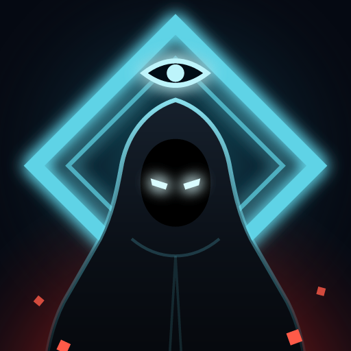

# Shadow Protocol



A side-scrolling stealth-action game about elevators, inspired by classic arcade spy games. This is the first playable vertical slice: one tower, three floors, one mission.

The whole game is a single `index.html` file with no build step and no dependencies. Open it in a browser to play.

**Play in the browser:** https://dayaramyavik-gds.github.io/shadow-protocol/

**Play on Android:** download the APK from the [latest release](https://github.com/dayaramyavik-GDs/shadow-protocol/releases/latest), open it on your phone, and allow installs from that source when Android asks.

## The mission

You come in through the roof of Halvorsen Tower.

1. Take the dossier from behind the red door on 2F.
2. Hack the security terminal on 2F to unlock elevator access to 1F.
3. Leave through the 1F lobby exit.

Optional goals: trigger no alarms, kill no one, and recover both intel folders.

## Controls

| Action | Keyboard | Touch |
| --- | --- | --- |
| Move | A / D or ← / → | ◀ ▶ |
| Crouch | S or ↓ | ▼ |
| Ride elevator | W / S inside the car | ▲ ▼ |
| Act (hide, hack, takedown, call elevator) | E | ACT |
| Fire | Space | FIRE |
| Reload | R | RELOAD |
| Throw decoy | Q | DECOY |
| Pause | P or Esc | II |

## What's in the slice

- An elevator that physically carries you between floors, with call buttons, a restricted floor, and a shutdown during lockdown.
- Two guard types (patrol and heavy) that patrol, investigate noises, search, fight, and react to bodies.
- A noise system: footsteps, gunfire, fuse boxes, and throwable decoys.
- A sweeping security camera that triggers a building lockdown with reinforcements.
- A three-stage timing hack that keeps the world running while you work.
- Fuse boxes that cut a floor's lights: the camera goes blind, guards switch to flashlights, and someone comes to turn the lights back on.
- Silent takedowns, doorway hiding, and crouching under high shots.
- Alert levels (Normal → Suspicious → Alert → Lockdown) that cool down over time.
- A debrief screen with a stealth grade and best score (stored locally in the browser).

All art is drawn in code and all sound is synthesized, so there are no external assets.

## Building the Android app

The Android app wraps `index.html` with [Capacitor](https://capacitorjs.com/) 6. You need Node.js, JDK 17 (Capacitor 6 does not build with newer JDKs), and the Android SDK with platform 35.

```bash
npm install
npm run sync
cd android
./gradlew assembleDebug
```

The APK is written to `android/app/build/outputs/apk/debug/app-debug.apk`. `npm run sync` copies `index.html` into `www/` and syncs it into the Android project, so run it after every change to the game. The app is locked to landscape.

### Play Store bundle (.aab)

```bash
cd android
./gradlew bundleRelease
```

The bundle is written to `android/app/build/outputs/bundle/release/app-release.aab`. Release builds are signed with an upload key that is kept outside the repo: by default the build reads `~/.shadow-protocol-signing/keystore.properties` (set `SHADOW_SIGNING_PROPS` to use another path). The file has four keys: `storeFile`, `storePassword`, `keyAlias`, `keyPassword`. Without it, `bundleRelease` produces an unsigned bundle that Google Play will reject.

### App icon

The launcher icon is drawn as two SVG layers in `icon/` (background and foreground, Android adaptive-icon format). After editing them, run `npm run icons` to regenerate every launcher size in `android/app/src/main/res/mipmap-*`, the launch splash screens in `drawable*/splash.png`, and `icon/play-store-icon-512.png` for the Play Store listing.
